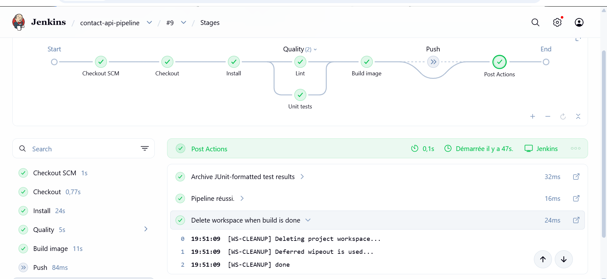
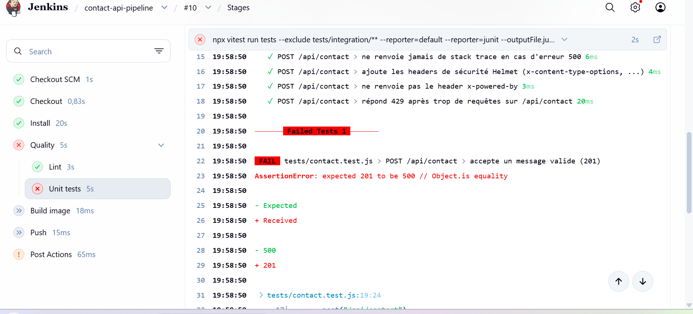
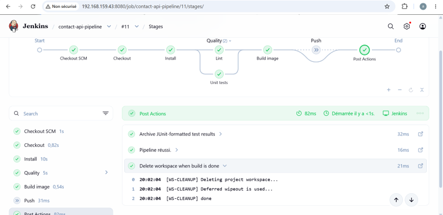
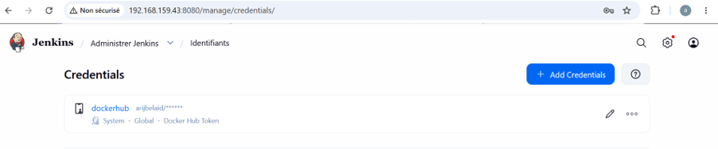
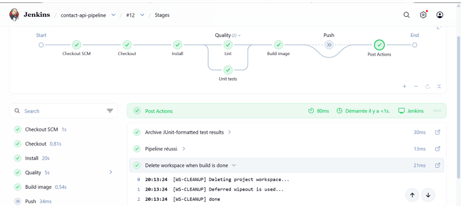
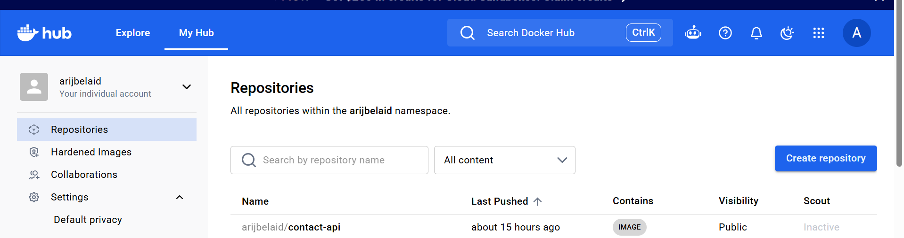
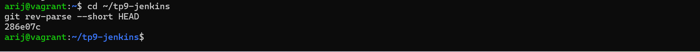
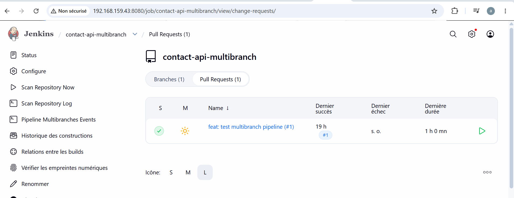

 
<div align="center">

# 🚀 TP9 — Pipeline as Code avec Jenkins

### Jenkinsfile · Docker Agents · Multibranch Pipeline · Shared Library

**Master DevOps & Cloud — ISET Tozeur**


</div>

---
## 📄 Rapport du TP

Le rapport détaillé de ce TP est disponible au format Word :

👉 **[Télécharger le rapport TP9](./rapport_tp9.docx)**

---

## 📌 Présentation

Ce TP a pour objectif de mettre en place un pipeline CI/CD avec Jenkins en utilisant l'approche **Pipeline as Code**.

Le pipeline est défini dans un fichier `Jenkinsfile` versionné avec le code source de l'application. Il permet d'automatiser les différentes étapes de l'intégration continue, notamment la vérification du code, l'exécution des tests, la génération des rapports et la publication de l'image Docker.

Ce travail permet également de découvrir les agents Docker, les pipelines multibranches et les Shared Libraries Jenkins.

## 🎯 Objectifs

- Définir un pipeline Jenkins à l'aide d'un `Jenkinsfile`.
- Automatiser l'installation des dépendances.
- Vérifier la qualité du code avec une étape de lint.
- Exécuter les tests unitaires avec Vitest.
- Générer et publier les rapports de tests JUnit.
- Utiliser des agents Docker pour exécuter les étapes du pipeline.
- Sécuriser les identifiants Docker Hub dans Jenkins.
- Construire et publier une image Docker avec un tag basé sur le commit Git.
- Mettre en place un pipeline multibranche.
- Réutiliser des fonctions Jenkins avec une Shared Library.

## 🛠️ Technologies utilisées

| Technologie | Utilisation |
|---|---|
| Jenkins | Automatisation CI/CD |
| Jenkinsfile | Définition du pipeline |
| Docker | Exécution des agents et conteneurisation |
| Node.js | Environnement d'exécution |
| npm | Gestion des dépendances |
| Vitest | Tests unitaires |
| JUnit | Rapports de tests |
| Git / GitHub | Gestion du code source |
| Docker Hub | Publication des images |
| Jenkins Shared Library | Réutilisation des étapes du pipeline |

---

## 📂 Structure du projet

```text
TP9/
├── captures/
│   ├── credentials-masked.png
│   ├── credentials-masked.png.png
│   ├── dockerhub-sha-tag.png
│   ├── dockerhub-sha-tag1.png
│   ├── junit-report.png.png
│   ├── junit-report1.png.png
│   ├── multibranch.png
│   └── pipeline-stages.png.png
│
├── Jenkinsfile
├── package.json
├── package-lock.json
├── Dockerfile
├── vars/
│   └── buildAndPush.groovy
└── README.md
```

> La structure ci-dessus présente les fichiers principaux du TP. Les fichiers de l'application peuvent varier selon ton dépôt.

---

# 🧪 Partie 1 — Pipeline Jenkins et stages

Cette première partie consiste à définir les étapes du pipeline Jenkins et à automatiser les vérifications du code source.

Les principales étapes sont :

- Checkout du dépôt Git.
- Installation des dépendances avec `npm ci`.
- Vérification du code avec Lint.
- Exécution des tests unitaires.
- Génération des rapports JUnit.
- Construction de l'image Docker.

## 📸 Capture 01 — Pipeline Jenkins



*Visualisation des étapes du pipeline Jenkins et de leur exécution.*

---

# 🧪 Partie 2 — Tests unitaires et rapports JUnit

Cette partie permet de vérifier le fonctionnement des tests unitaires et de générer des rapports exploitables par Jenkins.

Les tests sont exécutés avec Vitest et les résultats sont publiés au format JUnit.

L'objectif est de vérifier le comportement du pipeline lors de l'échec d'un test, puis après sa correction.

## 📸 Capture 02 — Rapport JUnit



*Capture du rapport de tests JUnit.*

## 📸 Capture 03 — Vérification des tests



*Capture complémentaire de la vérification des tests.*

---

# 🔐 Partie 3 — Gestion sécurisée des credentials

Cette partie consiste à configurer les identifiants Docker Hub dans Jenkins afin de permettre l'authentification lors de la publication de l'image Docker.

Les credentials sont enregistrés dans Jenkins et utilisés par le pipeline sans exposer directement le token dans le code source.

## 📸 Capture 04 — Credentials Jenkins



*Capture de la gestion des credentials Jenkins.*

## 📸 Capture 05 — Masquage des credentials



*Vérification du masquage des informations sensibles dans Jenkins.*

---

# 🐳 Partie 4 — Construction et publication de l'image Docker

Le pipeline automatise la construction de l'image Docker et sa publication sur Docker Hub.

L'image est identifiée à l'aide d'un tag basé sur le commit Git afin de faciliter la traçabilité des versions.

Le pipeline utilise les credentials Jenkins pour effectuer l'authentification auprès de Docker Hub.

## 📸 Capture 06 — Image Docker Hub et tag SHA



*Capture de l'image Docker publiée avec son tag basé sur le commit Git.*

## 📸 Capture 07 — Vérification du tag Docker



*Capture complémentaire de la vérification du tag de l'image Docker.*

---

# 🌿 Partie 5 — Multibranch Pipeline

Le Multibranch Pipeline permet à Jenkins de détecter et d'exécuter automatiquement un pipeline pour les différentes branches du dépôt Git.

Cette configuration facilite la gestion des branches de développement et la vérification des modifications avant leur intégration dans la branche principale.

Les principales fonctionnalités étudiées sont :

- Détection des branches Git.
- Création automatique des pipelines par branche.
- Analyse du dépôt GitHub.
- Exécution du pipeline selon la branche.
- Vérification des étapes de build.

## 📸 Capture 08 — Jenkins Multibranch Pipeline



*Visualisation du pipeline multibranche Jenkins.*

---

# 📚 Partie 6 — Jenkins Shared Library

La Shared Library permet de centraliser les fonctions réutilisables du pipeline Jenkins.

Elle facilite la maintenance du code Jenkins et évite de répéter les mêmes instructions dans plusieurs pipelines.

Dans ce TP, une fonction dédiée à la construction et à la publication de l'image Docker est utilisée.

Le pipeline peut charger la bibliothèque avec :

```groovy
@Library('ci-lib') _
```

La fonction réutilisable est appelée depuis le pipeline :

```groovy
buildAndPush(
    imageName: 'nom-image',
    tag: 'tag-image',
    registry: 'dockerhub'
)
```

> Les valeurs doivent correspondre à la configuration réelle du dépôt et de la Shared Library.

---

# ⚙️ Fonctionnement du pipeline

Le pipeline Jenkins est organisé autour des étapes suivantes :

| Étape | Description |
|---|---|
| Checkout | Récupération du code source Git |
| Install | Installation des dépendances |
| Lint | Vérification du code |
| Unit Tests | Exécution des tests unitaires |
| Build | Construction de l'image Docker |
| Push | Publication de l'image sur Docker Hub |
| Post | Publication des rapports et nettoyage |

Les étapes de Lint et Unit Tests peuvent être exécutées en parallèle.

La publication de l'image Docker dépend de la configuration de la branche et des credentials Jenkins.

---

# 🔒 Sécurité et bonnes pratiques

Les bonnes pratiques étudiées dans ce TP sont :

- Utilisation de credentials Jenkins pour les accès externes.
- Protection des tokens et mots de passe.
- Utilisation d'agents Docker pour isoler l'exécution.
- Versionnement du pipeline avec Git.
- Traçabilité des images Docker grâce aux tags.
- Réutilisation des fonctions avec une Shared Library.
- Vérification du code avant la publication de l'image.
- Publication des rapports de tests.

---

# ✅ Conclusion

Ce TP a permis de mettre en pratique les concepts fondamentaux de l'automatisation CI/CD avec Jenkins.

La mise en place d'un pipeline déclaratif permet d'automatiser les étapes de vérification, de test et de publication d'une application.

L'utilisation des agents Docker, des pipelines multibranches et des Shared Libraries améliore la réutilisabilité, la traçabilité et la maintenance du pipeline.

Ce travail constitue une étape importante dans la maîtrise des outils DevOps et des pratiques d'intégration continue.

---

<div align="center">

**Réalisé dans le cadre du Master DevOps & Cloud — ISET Tozeur**

</div>
